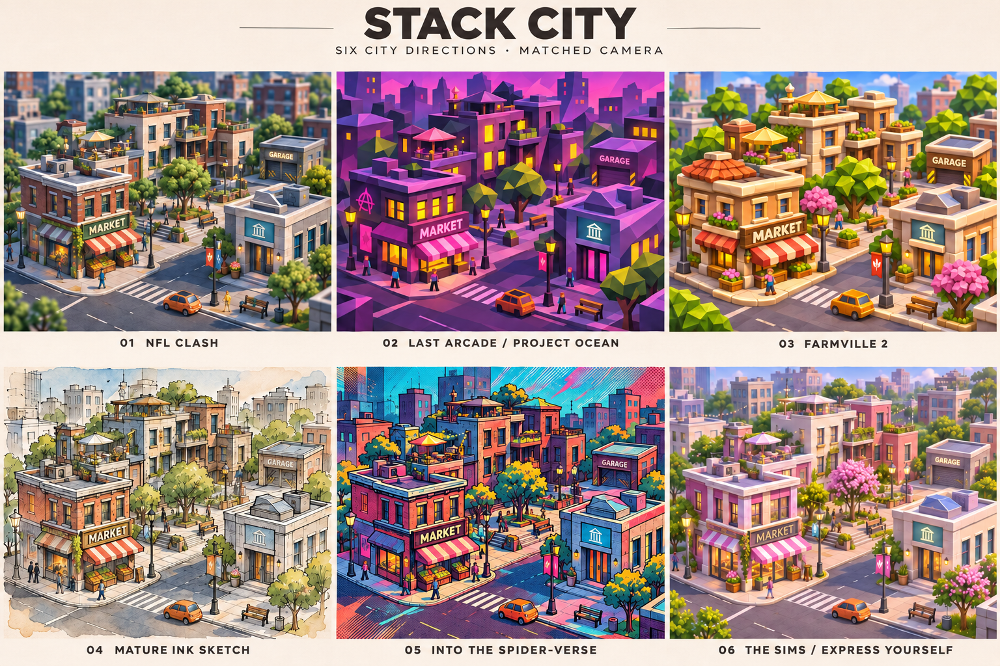

# Stack City

A small playable financial-literacy scenario for ages 13–17, with a Three.js neighborhood and separate simulation, learning progression, and cosmetic currencies.

**Current milestone: 2026-11-03.** Working browser prototype and editable Figma file delivered. Figma owner team: **aklein personal**.

## Latest design discussion — 2026-11-05

- [Design folder: hiring brief, UI/UX priorities, and AI workflow](docs/design/README.md)
- [Exploration folder: rankings, City-States, and reusable discussion excerpts](docs/exploration/README.md)

This is an untimed art-direction and UI/UX fit exploration. The new notes distinguish owner decisions, the hiring brief, and proposed directions. They preserve the existing prototype/art studies as a baseline; they do not claim that the newly discussed concepts have been implemented. LoRA training is not a current deliverable.

## City art direction

[Download the six market styles — Three.js and Blender GLBs](https://github.com/aklein00/world_farm/tree/main/market-kit-v1)

[Four mobile city style sheets — 16 options](output/concepts/mobile-style-studies/README.md)

[Six-direction concept sheet](output/concepts/city-style-comparison-v02.png) · [References and generation prompts](output/concepts/README.md)



## Preview

- [Working browser preview](https://stack-city-playable-week.aklein00.chatgpt.site) — owner-private; sign in with the owning account.
- [Figma editor](https://www.figma.com/design/KceyHEQvNCH8jigHOgqSRW)
- [Figma click-through prototype](https://www.figma.com/proto/KceyHEQvNCH8jigHOgqSRW?node-id=5-2&starting-point-node-id=5%3A2)
- [Milestone, decisions and validation](docs/MILESTONE_2026-11-03.md)
- [Asset handoff](docs/ASSET_CHECKLIST.md)

## Run from a fresh checkout

Requires Python 3. No package installation or build step is needed.

```sh
cd prototype
python3 -m http.server 4318 --directory dist
```

Open `http://localhost:4318`. The same server is available through `npm run dev`. Serve over HTTP; opening `index.html` directly does not support module loading. Three.js r181 and its MIT license are vendored under `dist/vendor/three`. Fonts use Google Fonts with local fallbacks.

With Node.js installed, `npm run check` checks JavaScript syntax. Run `npm test` for the six economy regression tests.

## Design and implementation

- [Figma specification and current coverage](docs/FIGMA_WIREFRAMES.md)
- [Roadmap](docs/ROADMAP.md)
- [Figma node ledger](docs/FIGMA_STATE.json)
- [Curated Figma scenario definitions](docs/PROTOTYPE_SCREENS.json)

Scenario values and copy live in `prototype/dist/scenario.js`; transaction rules in `economy.js`; the 3D neighborhood in `city.js`; navigation in `app.js`. Keep those boundaries when changing the premise, educational approach, or game loop. Progress is session-only: refreshing starts over. No real purchases or financial accounts are connected.

Earlier planning documents are retained for context; this milestone and current source describe implemented scope. Final production art, broader device testing, and user research remain future work.
